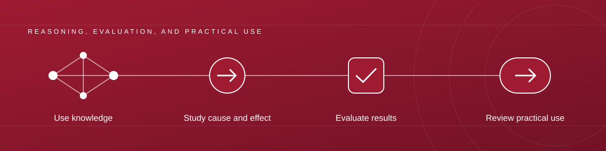
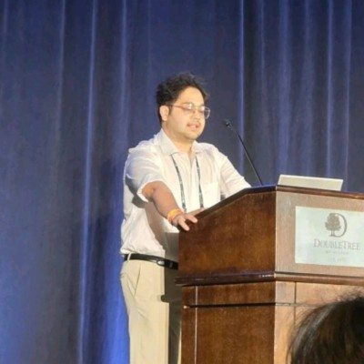

# Reasoning to Readiness

### Neuro-Symbolic and Causal Architectures for Reliable AI Agents

**A proposed AAAI 2027 Spring Symposium · March 22–24, 2027 · Santa Clara University, California**

[Call for papers](cfp.html) · [Express interest](https://forms.gle/RUvA879SEs7ypqVc9) · [Proposal PDF](proposal/proposal.pdf?v=20261112-final-copy) · [Official AAAI call](https://aaai.org/conference/spring-symposia/aaai-2027-spring-symposium-series-call-for-proposal/)

## Overview

**How can we tell when an AI agent is ready for use beyond a demonstration?**

Reasoning to Readiness (R2R) brings together researchers and practitioners studying how AI agents use memory, knowledge, rules, and causal models. We will examine what these approaches contribute to reliable behavior, where they fail, and how to evaluate them in practical settings.

Participants will discuss research and case studies, compare designs, and work through two labs. Together, we will develop guidance on what to test before a pilot, how to report results, and which decisions should remain with people.

The symposium draws on cognitive architectures [R1], neuro-symbolic AI [R2], causal representation learning [R3], and language agents that combine reasoning with action [R4]. Research on evaluation costs [R5] and attacks through tool outputs [R6] highlights the need to measure more than task accuracy. NIST AI RMF 1.0 provides a reference for discussing risk [R7].

We aim to bring together **50–65 participants** from AI research, industry, operations, software testing, and related fields, including students.

## Research agenda

### 01 · Cognitive architectures and memory

How should memory, learning, planning, and human review work together? Topics include tracking where stored information came from, updating outdated knowledge, reusing skills across tasks, and checking whether learning a new task harms earlier capabilities.

### 02 · Neuro-symbolic reasoning and action

How can knowledge graphs, ontologies, rules, and executable checks improve an agent's decisions? We will examine which parts of a system check or authorize actions, what those checks cover, and how the system responds to missing or conflicting information.

### 03 · Causal reasoning and decision support

What can an agent conclude about the effects of an action? Topics include causal models, interventions, counterfactual questions, and uncertainty. Contributions should explain the assumptions behind a conclusion and when the agent should ask for more information or human help.

### 04 · Evaluation and practical use

What should be measured before an agent is used in a real workflow? Topics include integration with existing systems, access permissions, changes in data or operating conditions, error detection, recovery, cost, and the time required for human review.

## Industry readiness

We will discuss each system’s data, reasoning, permissions, reliability, cost, and human oversight.

| Area | Main question | What to report |
| --- | --- | --- |
| Knowledge and data | Is the information suitable and up to date? | Sources, versions, permissions, and known gaps. |
| Reasoning | Do the tests support the system's claims? | Assumptions, comparisons, results, and limitations. |
| Permissions and security | Can the agent act only within its authority? | Access controls, approval checks, and security tests. |
| Reliability and recovery | What happens when something goes wrong? | Error detection, human intervention, and recovery tests. |
| Cost and usefulness | Does it improve on a reasonable alternative? | Task success, response time, computing cost, and staff effort. |
| Human responsibility | Who reviews decisions and changes? | Review procedures, responsibilities, and incident handling. |

Reports should describe the test conditions, sample sizes, findings, uncertainty, and limits of the evaluation.

### Labs

**Lab 1: Designing an agent.** Groups will work with a fictional supplier-delay and approval process. They will identify the information and permissions the agent needs, compare possible designs with a simpler approach, and decide how to test them.

**Lab 2: Testing failures and recovery.** Groups will examine outdated information, conflicting instructions, missing approvals, and tool failures. They will specify how the agent should respond and which decisions require human review. A second case from service operations will test whether the same methods are useful in a different setting.

**Panel discussion.** Researchers and practitioners will review example cases and discuss whether the available results support a pilot and what further testing is needed.

Paper worksheets and simple local examples will be available. Coding is optional, and participation will not require paid APIs or specialized hardware. Exercises will use fictional, public, or approved material.

## Program

All times are local to Santa Clara (Pacific Daylight Time, UTC−7).

### Monday, March 22: Architectures and applications

| Time | Session |
| --- | --- |
| 09:00–09:20 | Welcome and introduction to the symposium questions. |
| 09:20–10:00 | Invited talk and discussion: Nigel Glenday (Graphite Atlas). |
| 10:00–10:30 | Application challenges from research and industry. |
| 10:30–11:00 | Coffee break. |
| 11:00–12:30 | Contributed talks on memory, knowledge representation, and planning, followed by discussion. |
| 12:30–14:00 | Lunch. |
| 14:00–15:30 | Lab 1: designing an agent for supplier delays and approval decisions. |
| 15:30–16:00 | Coffee break. |
| 16:00–17:00 | Group reports and discussion of the proposed designs. |
| 18:00–19:00 | AAAI series reception. |

### Tuesday, March 23: Evaluation and failure analysis

| Time | Session |
| --- | --- |
| 09:00–09:40 | Invited talk and discussion: Raj Krishnan (AI For Services). |
| 09:40–10:30 | Case studies: evaluation results and deployment experience. |
| 10:30–11:00 | Coffee break. |
| 11:00–12:30 | Lab 2: testing outdated information, missing approvals, and tool failures. |
| 12:30–14:00 | Lunch. |
| 14:00–15:30 | Panel and audience discussion: when is an agent ready for a pilot? |
| 15:30–16:00 | Coffee break. |
| 16:00–17:00 | Poster session: accepted papers and poster abstracts, with discussion at each poster. |
| 18:00–19:00 | AAAI series plenary. |

### Wednesday, March 24: Open questions and next steps

| Time | Session |
| --- | --- |
| 09:00–10:30 | Lab reports and discussion of the results. |
| 10:30–11:00 | Coffee break. |
| 11:00–12:00 | Discussion of open research questions and possible joint studies. |
| 12:00–12:30 | Closing discussion and next steps. |

The 90-minute contributed-paper session will include short talks and questions. Accepted papers not selected for an oral talk, together with accepted poster abstracts, will be presented in the Tuesday poster session. Authors will be available to discuss their work at their posters. Both labs are open to all participants; coding is optional.

## Participation

### Express interest now

Complete the **[interest form](https://forms.gle/RUvA879SEs7ypqVc9)** with your name, affiliation, and interests, or contact [Dr. Kaushik Roy](mailto:kroy2@ua.edu?subject=R2R%202027%20expression%20of%20interest). You can express interest without committing to attend.

In the form, please indicate whether we may include your name and affiliation in the proposal and whether you agree to a public listing.

### Proposed contribution formats after acceptance

The **[call for papers and participation](cfp.html)** gives the topics, submission guidance, and review process.

| Contribution | Proposed length |
| --- | --- |
| Long research and position papers; industry and operational case studies | Up to 4 pages |
| Short research and position papers; demonstrations | Up to 2 pages |
| Poster abstracts; participation statements | Up to 1 page |

**Oral talks and posters.** A limited number of accepted papers will be selected for the 90-minute oral session. Other accepted papers and accepted poster abstracts will be presented in the **poster session on Tuesday, March 23, 16:00–17:00**. Authors will discuss their work with participants at their posters. The same review criteria apply to papers presented orally and as posters.

We welcome early work and negative results. Reviews will consider relevance, clarity, the methods and results appropriate to the submission, and its value for discussion. Reviewers with a conflict of interest will not assess a submission.

Submissions will open if AAAI accepts the symposium. Final deadlines, formatting, submission instructions, and publication arrangements will be announced after coordination with AAAI.

### Attendance and accessibility

Presentations, including posters, will be in person, and all participants, including organizers, must register with AAAI. Registration, travel, accommodation, and visa information will follow AAAI's processes. [Official guidance](https://aaai.org/conference/spring-symposia/aaai-2027-spring-symposium-series-call-for-proposal/)

We will provide readable materials, allow time for questions, and offer written ways to contribute during sessions. Accessibility and any livestream requests will be discussed with AAAI and the venue. AAAI's event Code of Conduct applies. [Series information](https://aaai.org/conference/spring-symposia/aaai-2027-spring-symposium-series/)

## Speakers

### Invited speakers

<h3>Nigel Glenday</h3>

<strong>Monday, March 22 · 09:20–10:00</strong> Graphite Atlas

Nigel Glenday is the founder and CEO of Graphite Atlas, which maps business processes and develops automation and AI systems. He previously held CFO and COO roles in asset management. His work connects business operations with the practical use of AI.

<a href="https://www.graphiteatlas.com/">Company profile</a> · <a href="mailto:nglenday@graphiteatlas.com">Contact</a>

<h3>Raj Krishnan</h3>

<strong>Tuesday, March 23 · 09:00–09:40</strong> AI For Services

Raj Krishnan is with AI For Services, a company developing AI applications for business processes. Its work includes automating requests for proposals and customer-support workflows, and connecting AI applications with existing enterprise systems.

<a href="https://aiforservices.com/">Company website</a> · <a href="mailto:raj@aiforservices.com">Contact</a>

Talk titles will be announced.

## Organizers

### Organizing Committee

<h3>Dr. Kaushik Roy</h3>

<strong>Lead organizer · Scientific program</strong> Assistant Professor of Computer Science, The University of Alabama.

Program planning, paper review, invitations, and coordination with AAAI.

<a href="https://eng.ua.edu/eng-directory/dr-kaushik-roy/">UA faculty profile</a>

<a href="mailto:kroy2@ua.edu">kroy2@ua.edu</a>

<h3>Dr. Shahram Rahimi</h3>

<strong>Faculty organizer · Research program</strong> Professor and Head of the Department of Computer Science, The University of Alabama.

Invitations to researchers and discussions across AI research and industry.

<a href="https://eng.ua.edu/eng-directory/dr-shahram-rahimi/">Faculty profile</a>

<a href="mailto:srahimi1@ua.edu">srahimi1@ua.edu</a>

<h3>Dr. Subash Neupane</h3>

<strong>Faculty organizer · Evaluation</strong> Assistant Professor, The University of Alabama.

Evaluation, explainability, and AI applications in healthcare and other settings.

<a href="https://eng.ua.edu/eng-directory/dr-subash-neupane/">Faculty profile</a>

<a href="mailto:sneupane4@ua.edu">sneupane4@ua.edu</a>

<h3>Dr. Noorbakhsh Amiri Golilarz</h3>

<strong>Cognitive systems · Lab design</strong> Assistant Professor of Computer Science, The University of Alabama; Director of the BRAINS Lab.

His research includes AI, computer vision, robotics, and cognitive neuroscience. He will contribute to lab design and discussions of cognitive systems and applications.

<a href="https://eng.ua.edu/eng-directory/dr-noorbakhsh-amiri-golilarz/">UA faculty profile</a> · <a href="https://sites.ua.edu/brains/team/">BRAINS Lab</a>

<a href="mailto:namirigolilarz@ua.edu">namirigolilarz@ua.edu</a>

<h3>Himanshu Tripathi</h3>

<strong>Student organizer</strong> The University of Alabama.

Student organizing support and symposium coordination.

<a href="https://sites.ua.edu/brains/team/">BRAINS Lab profile</a>

<a href="mailto:htripathi@crimson.ua.edu">htripathi@crimson.ua.edu</a>

<h3>Ashraf Abdul-Muumin</h3>

<strong>Student organizer</strong> The University of Alabama.

Student organizing support and symposium coordination.

<a href="https://github.com/chirix33">Profile</a>

<a href="mailto:aashraf@crimson.ua.edu">aashraf@crimson.ua.edu</a>

### Advisory Committee

Scientific advice on the symposium's scope and research directions.

<h3>Dr. Alessandro Oltramari</h3>

<strong>Scientific adviser</strong> Senior Manager, Bosch Research; President, Carnegie Bosch Institute.

His research connects knowledge representation, learning, and neuro-symbolic AI.

<a href="https://carnegiebosch.cmu.edu/team/bios/oltramari-alessandro.html">Profile</a>

<a href="mailto:aoltrama@andrew.cmu.edu">aoltrama@andrew.cmu.edu</a>

<h3>Prof. Amit Sheth</h3>

<strong>Scientific adviser</strong> Professor of Computer Science and Engineering, University of South Carolina; founding director of its Artificial Intelligence Institute.

His research includes knowledge graphs, natural language processing, and AI systems that combine knowledge with learned models.

<a href="https://sc.edu/study/colleges_schools/engineering_and_computing/faculty-staff/amitsheth.php">Faculty profile</a>

<a href="mailto:amit@sc.edu">amit@sc.edu</a>

## Dates and status

| Milestone | Date or status |
| --- | --- |
| Organizer proposal due to AAAI | **November 17, 2026**. |
| AAAI proposal decisions | **December 8, 2026**. |
| AAAI series registration opens | **December 29, 2026**. |
| R2R paper/case submission deadline | Not announced; contingent on symposium acceptance. |
| Invited speakers | Nigel Glenday (Monday) and Raj Krishnan (Tuesday); talk titles to be announced. |
| Proposed symposium | **March 22–24, 2027** at Santa Clara University. |

## References

**R1.** John E. Laird, Christian Lebiere, and Paul S. Rosenbloom. 2017. A Standard Model of the Mind: Toward a Common Computational Framework across Artificial Intelligence, Cognitive Science, Neuroscience, and Robotics. *AI Magazine*, 38(4), 13–26. [doi:10.1609/aimag.v38i4.2744](https://doi.org/10.1609/aimag.v38i4.2744).

**R2.** Artur d'Avila Garcez and Luis C. Lamb. 2023. Neurosymbolic AI: the 3rd wave. *Artificial Intelligence Review*. [doi:10.1007/s10462-023-10448-w](https://doi.org/10.1007/s10462-023-10448-w).

**R3.** Bernhard Schölkopf, Francesco Locatello, Stefan Bauer, Nan Rosemary Ke, Nal Kalchbrenner, Anirudh Goyal, and Yoshua Bengio. 2021. Toward Causal Representation Learning. *Proceedings of the IEEE*. [doi:10.1109/JPROC.2021.3058954](https://doi.org/10.1109/JPROC.2021.3058954).

**R4.** Shunyu Yao, Jeffrey Zhao, Dian Yu, Nan Du, Izhak Shafran, Karthik Narasimhan, and Yuan Cao. 2023. ReAct: Synergizing Reasoning and Acting in Language Models. *ICLR*. [NSF public-access record](https://par.nsf.gov/biblio/10451467-react-synergizing-reasoning-acting-language-models).

**R5.** Sayash Kapoor, Benedikt Stroebl, Zachary S. Siegel, Nitya Nadgir, and Arvind Narayanan. 2024. AI Agents That Matter. *arXiv:2407.01502*. [Preprint](https://arxiv.org/abs/2407.01502).

**R6.** Edoardo Debenedetti, Jie Zhang, Mislav Balunovic, Luca Beurer-Kellner, Marc Fischer, and Florian Tramèr. 2024. AgentDojo: A Dynamic Environment to Evaluate Prompt Injection Attacks and Defenses for LLM Agents. *NeurIPS Datasets and Benchmarks*. [Proceedings](https://proceedings.nips.cc/paper_files/paper/2024/hash/97091a5177d8dc64b1da8bf3e1f6fb54-Abstract-Datasets_and_Benchmarks_Track.html).

**R7.** National Institute of Standards and Technology. 2023. Artificial Intelligence Risk Management Framework (AI RMF 1.0). *NIST AI 100-1*. [Publication](https://www.nist.gov/publications/artificial-intelligence-risk-management-framework-ai-rmf-10).

