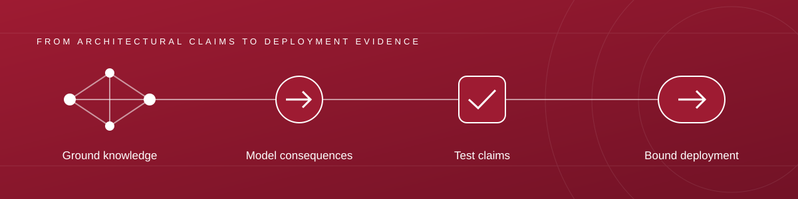

# Reasoning to Readiness

### Neuro-Symbolic and Causal Architectures for Reliable AI Agents

**A proposed AAAI 2027 Spring Symposium · March 22–24, 2027 · Santa Clara University, California**

> **Proposal-stage website.** This symposium has not been accepted by AAAI. The program, organizing roles, contribution formats, and intended outcomes below are proposed. No invited speakers, sponsors, or participant commitments are being claimed. Expressions of interest are welcome; this site is not a paper-submission or registration portal.

[Express interest](mailto:kroy2@ua.edu?subject=R2R%202027%20expression%20of%20interest) · [Proposal PDF](proposal/proposal.pdf) · [Editable proposal](https://github.com/kauroy1994/AAAI-Symposium-Concept/blob/main/proposal/proposal.md) · [Official AAAI call](https://aaai.org/conference/spring-symposia/aaai-2027-spring-symposium-series-call-for-proposal/)

## Overview

**What evidence should justify moving an AI agent from a convincing demonstration to a bounded, accountable deployment?**

Reasoning to Readiness (R2R) proposes a working symposium at the intersection of cognitive architectures, neuro-symbolic AI, causal modeling, and industrial operations. Rather than treating deployment as a final engineering step, we ask how the architecture itself can expose its knowledge, assumptions, action boundaries, failure modes, and resource requirements to the people responsible for using it.

Our central activity is the co-design of a **deployment evidence contract**: a structured record connecting an agent's intended use and architectural claims to testable acceptance criteria, supporting artifacts, unresolved risks, and a named human decision-maker. This is a proposed research artifact, not a certification scheme or a claim that any architecture is inherently safe.

The scientific foundations include cognitive architectures that connect memory and action [R1], neuro-symbolic integration [R2], causal representation learning [R3], and reasoning-and-acting language agents [R4]. Cost-aware agent evaluation [R5] and adversarial tool-use evaluation [R6] motivate looking beyond task accuracy. NIST AI RMF 1.0 provides a documented risk-management reference [R7], not an endorsement or a substitute for domain-specific obligations.

**Intended community:** researchers in AI, knowledge representation, planning, cognitive systems, causality, and evaluation; industrial AI developers; operations leaders; assurance practitioners; and students. We propose approximately **50–65 participants**, within AAAI's published target range of 40–75. These are planning targets, not registrations. [Official call](https://aaai.org/conference/spring-symposia/aaai-2027-spring-symposium-series-call-for-proposal/)

## Research agenda

### 01 · Cognitive architectures and adaptive memory

How should working memory, persistent knowledge, planning, reflection, and human oversight interact? We welcome architectures that make state changes inspectable, separate remembered evidence from generated hypotheses, and evaluate adaptation without silently discarding earlier capabilities. Discussion will address memory provenance, stale knowledge, cross-task reuse, and the cost of maintaining abstractions.

### 02 · Neuro-symbolic grounding and verifiable action

How can ontologies, knowledge graphs, process models, constraints, and executable specifications guide neural systems without making them brittle? We will distinguish a useful structural inductive bias from a demonstrated behavioral guarantee. Proposed studies should identify which component enforces a constraint, what assumptions enforcement requires, and what happens when those assumptions fail.

### 03 · Causal and counterfactual decision support

When does an agent have enough evidence to answer an intervention or counterfactual question? Topics include causal event models, structural assumptions, uncertainty, identification limits, simulation-based evaluation, and clarification when evidence is insufficient. A plausible explanation is not, by itself, evidence of causal identification or counterfactual correctness.

### 04 · Industry readiness and accountable operation

What must be measured before a system is exposed to consequential workflows? Topics include integration boundaries, access controls, task success under distribution shift, human intervention, observability, recovery, total operating cost, and changes to work practices. Industry participation will center on technical evidence and limitations, not sales presentations.

## Industry readiness

The proposed readiness assessment is a **profile of evidence**, not a single leaderboard score. A system that succeeds on a task but lacks authorization controls should not compensate for that deficit with higher accuracy.

| Readiness dimension | Questions for a deployment review | Expected evidence |
| --- | --- | --- |
| Knowledge and data | What is trusted, current, licensed, and traceable? | Source lineage, versioned knowledge, data limitations, missing-evidence behavior. |
| Reasoning and causal validity | Which claims are checked, and under what assumptions? | Executable tests, constraint checks, causal assumptions, calibrated abstention. |
| Authority and security | Which actions may the agent perform, and who authorizes them? | Tool permissions, approval boundaries, isolation tests, adversarial test results. |
| Reliability and recovery | What happens under drift, tool failure, or partial completion? | Failure taxonomy, monitoring signals, escalation, rollback and recovery exercises. |
| Efficiency and business value | Is the system useful relative to a credible alternative? | Task success alongside latency, compute, cost, operator time, and uncertainty. |
| Human and organizational oversight | Who owns decisions, residual risk, and change control? | Named responsibilities, review records, incident procedure, user feedback. |

**Evidence states:** demonstrated within a stated scope; partially supported; unsupported; or not applicable with a justification. Teams will document sample sizes, test conditions, and uncertainty instead of assigning an unsupported universal readiness level. Mapping an artifact to NIST AI RMF terminology does not establish certification, legal compliance, or permission to deploy.

### Case-based labs

**Lab A — Knowledge-to-action clinic.** Mixed research–industry groups will examine a synthetic supplier-delay and approval workflow. They will identify required knowledge, represent dependencies and action permissions, compare a simple baseline with a proposed agent design, and specify the evidence needed for a bounded pilot. The exercise is a design and evaluation activity; no production customer data or live transactions are required.

**Lab B — Failure, intervention, and recovery.** Groups will introduce stale knowledge, contradictory instructions, missing approvals, and tool failures into a documented scenario. They will distinguish ordinary constraint violations from causal interventions, identify unsupported conclusions, and design escalation and recovery tests. A second service-operations scenario will test whether the evidence contract transfers beyond manufacturing.

**Deployment review panel.** Researchers, practitioners, and operations stakeholders will review anonymized case packets and explain which evidence supports a pilot, which evidence is missing, and which risks remain. This is a research discussion, not a procurement decision or a certification service.

**Access:** paper-based worksheets and lightweight local examples are planned alongside optional coding. Participants should not need a paid API account, specialized accelerator, or proprietary platform to contribute. All exercises will use synthetic, public, or explicitly authorized material.

## Program

**Preliminary two-and-a-half-day program. All times are local to Santa Clara (Pacific Daylight Time, UTC−7).** The session blocks follow AAAI's published general schedule; the symposium-specific activities below are proposals. Invited-speaker slots are unassigned. [AAAI series schedule](https://aaai.org/conference/spring-symposia/aaai-2027-spring-symposium-series/)

### Monday, March 22 · Architectures meet operational requirements

| Time | Session | Intended output |
| --- | --- | --- |
| 09:00–09:20 | Welcome, scope, and shared target problem | Common vocabulary and case boundaries. |
| 09:20–10:00 | Invited perspective and discussion; speaker to be confirmed | Competing views on cognitive architecture and agent reliability. |
| 10:00–10:30 | Research–industry problem statements | Concrete deployment questions rather than product pitches. |
| 10:30–11:00 | AAAI break | Informal exchange. |
| 11:00–12:30 | Contributed research and position talks with structured discussion | Architectural claims and evidence gaps. |
| 12:30–14:00 | Lunch break | No symposium session. |
| 14:00–15:30 | Lab A: knowledge-to-action clinic | First deployment evidence contracts. |
| 15:30–16:00 | AAAI break | Informal exchange. |
| 16:00–17:00 | Cross-group critique and design revisions | Revised assumptions and test plans. |
| 18:00–19:00 | AAAI series reception | Series-level activity; not organized by R2R. |

### Tuesday, March 23 · Stress-test the path to deployment

| Time | Session | Intended output |
| --- | --- | --- |
| 09:00–09:40 | Invited industry perspective and discussion; speaker to be confirmed | Operational failure modes and adoption constraints. |
| 09:40–10:30 | Evidence-centered case reports and discussion | Baselines, limitations, and lessons from unsuccessful approaches. |
| 10:30–11:00 | AAAI break | Informal exchange. |
| 11:00–12:30 | Lab B: failure, intervention, and recovery | Failure taxonomy and recovery test specifications. |
| 12:30–14:00 | Lunch break | No symposium session. |
| 14:00–15:30 | Deployment review panel and open challenge | Defensible pilot boundaries and unresolved risks. |
| 15:30–16:00 | AAAI break | Informal exchange. |
| 16:00–17:00 | Working groups: evaluation, governance, and transfer | Draft community artifacts with explicit disagreements. |
| 18:00–19:00 | AAAI series plenary | Series-level activity; not organized by R2R. |

### Wednesday, March 24 · Consolidate a research agenda

| Time | Session | Intended output |
| --- | --- | --- |
| 09:00–10:30 | Cross-domain synthesis and artifact review | A revised evidence contract and comparative case matrix. |
| 10:30–11:00 | AAAI break | Informal exchange. |
| 11:00–12:00 | Research roadmap: open problems and collaborative experiments | Prioritized questions, candidate owners, and resource needs. |
| 12:00–12:30 | Community review and closing | Agreed next steps and a record of unresolved issues. |

Within the contributed-talk blocks, we propose short presentations with substantial respondent and audience time. The program reserves **570 of 840 technical-session minutes** for the explicitly collaborative labs, critiques, panel, working groups, and final-day synthesis; additional discussion is included within talk blocks. Breaks, lunch, reception, and plenary are excluded from this calculation.

## Participation

### Express interest now

Email **[Dr. Kaushik Roy](mailto:kroy2@ua.edu?subject=R2R%202027%20expression%20of%20interest)** with your name, affiliation, relevant interests, and a brief statement that you are interested in participating should the symposium be accepted. An expression of interest is **not a commitment to attend** and does not reserve a place.

Please indicate separately whether we may include your **name and affiliation in the proposal reviewed by AAAI**, and whether you consent to a **public listing**. Public listing is optional. Do not send confidential customer information, sensitive datasets, credentials, or private case records. Correspondence will be used for symposium planning and handled through the lead organizer, not committed to this public repository.

### Proposed contribution formats after acceptance

We plan to invite short research and position papers, evidence-centered industry case studies, reproducible demonstrations, negative results, and participation statements from practitioners and students. Proposed lengths are **2–4 pages for papers/cases**, **2 pages for demonstrations**, and **1 page for participation statements**. These are organizer proposals, not AAAI-mandated limits. Final formatting, submission deadlines, review procedures, and archival options will be announced only after acceptance and coordination with AAAI.

The proposed review criteria are relevance, clarity of the research question, quality and limits of evidence, value for discussion, and potential to connect communities. Early-stage and speculative work is welcome when labeled accurately. Commercial affiliation is neither a prerequisite nor an advantage. Conflicts of interest will be managed through recusal and an independent reviewer; reviewers will not evaluate their own or closely related submissions.

### Attendance and accessibility

AAAI requires **all presenters, keynote speakers, and panelists to present in person**, and all participants, including organizers, to register. AAAI states that a livestream for remote attendees can be arranged on request; **no livestream or remote participation arrangement is promised here**. Registration, travel, accommodation, visa letters, and any accessibility arrangements will follow AAAI's official processes. [Official policy](https://aaai.org/conference/spring-symposia/aaai-2027-spring-symposium-series-call-for-proposal/)

We propose accessible materials, structured turn-taking, student-friendly activities, and written participation routes within the in-person sessions. We will coordinate requests with AAAI and the venue without promising services or funding that have not been secured. The AAAI event Code of Conduct will apply. [Series information](https://aaai.org/conference/spring-symposia/aaai-2027-spring-symposium-series/)

## Organizers

**Proposed organizing committee.** Four senior organizers and two University of Alabama student organizers. Roles remain proposed until explicit agreement to serve. Institutional affiliation does not imply endorsement.

<h3>Dr. Kaushik Roy</h3>

<strong>Lead organizer · Scientific program</strong> Assistant Professor of Computer Science, The University of Alabama.

Scientific scope, paper review, community recruitment, and AAAI liaison.

<a href="https://cs.ua.edu/faculty-staff/our-new-fall-2025-faculty/">UA faculty announcement and portrait source</a>

<h3>Nigel Glenday</h3>

<strong>Industry problems · Operational design</strong> Founder and CEO, Graphite Atlas.

Practitioner recruitment, operational problem statements, and the knowledge-to-action clinic.

<a href="https://www.graphiteatlas.com/">Company team profile and portrait source</a>

RK

<h3>Raj Krishnan</h3>

<strong>Enterprise integration · Adoption</strong> Founder and CEO, AI For Services (lead-organizer supplied; independently unconfirmed).

Service-workflow case design, integration requirements, and adoption challenges.

<a href="https://www.linkedin.com/company/aiforservices">Company page</a>

<h3>Dr. Alessandro Oltramari</h3>

<strong>Neuro-symbolic architecture · Research translation</strong> Senior Manager, Bosch Research; President, Carnegie Bosch Institute.

Architecture discussion, academia–industry translation, and deployment review.

<a href="https://carnegiebosch.cmu.edu/team/bios/oltramari-alessandro.html">Official CBI profile and portrait source</a>

HT

<h3>Himanshu Tripathi</h3>

<strong>Student organizer</strong> The University of Alabama.

Listed by the UA BRAINS Lab as a PhD student; its team page includes a portrait, but the specific image URL is not yet independently verified.

<a href="https://sites.ua.edu/brains/team/">Official UA BRAINS Lab team page</a>

<h3>Ashraf Abdul-Muumin</h3>

<strong>Student organizer</strong> The University of Alabama (lead-organizer supplied).

Image is from Ashraf's own authenticated GitHub profile, not from a UA portrait directory.

<a href="https://github.com/chirix33">Self-published GitHub profile</a>

**Photo provenance:** Portraits are linked from institutional, employer, or self-managed public profiles rather than re-uploaded. No photograph is guessed for Raj or Himanshu. Because third-party image links can change or block embedding, [the verification record](PHOTO-SOURCES.md) gives each origin and outstanding checks. Photos and affiliations do not establish consent to serve; all organizer participation remains subject to confirmation.

For student-organizer coordination and prospective headshot corrections, contact [Dr. Kaushik Roy](mailto:kroy2@ua.edu).

## Dates and status

| Milestone | Date or status |
| --- | --- |
| Organizer proposal due to AAAI | **November 17, 2026**; follow the official call's EasyChair link. The call does not specify a deadline timezone. |
| AAAI proposal decisions | **December 8, 2026**. |
| AAAI series registration opens | **December 29, 2026**, as listed on the series page; subject to AAAI updates. |
| R2R paper/case submission deadline | Not announced; contingent on symposium acceptance. |
| R2R speaker and program announcements | Not announced; consent and confirmations required. |
| Proposed symposium | **March 22–24, 2027** at Santa Clara University. |

Sources: [official proposal call](https://aaai.org/conference/spring-symposia/aaai-2027-spring-symposium-series-call-for-proposal/) and [official series information](https://aaai.org/conference/spring-symposia/aaai-2027-spring-symposium-series/). Content checked October 27, 2026. Please consult AAAI for subsequent changes.

## Outcomes and resources

The proposed outputs are a deployment evidence contract, a failure-and-recovery taxonomy, a cross-domain case matrix, and a research roadmap. These will record both agreement and unresolved questions. We propose circulating an organizer-edited synthesis within six weeks after the event, subject to author consent and review; this is an intended activity, not a publication commitment.

[Evidence-contract worksheet](https://github.com/kauroy1994/AAAI-Symposium-Concept/blob/main/resources/evidence-contract.md) · [Case-study template](https://github.com/kauroy1994/AAAI-Symposium-Concept/blob/main/resources/case-study-template.md) · [Outreach and consent templates](https://github.com/kauroy1994/AAAI-Symposium-Concept/blob/main/resources/outreach.md) · [Submission checklist](https://github.com/kauroy1994/AAAI-Symposium-Concept/blob/main/proposal/submission-checklist.md) · [Fact-check record](https://github.com/kauroy1994/AAAI-Symposium-Concept/blob/main/SOURCES.md)

**Not a continuation of an existing event series.** The proposal is intentionally narrower than a general neuro-symbolic AI or agent workshop. NeSy already runs an annual conference and included an industry track in 2026. Our proposed contribution is a focused, jointly authored evidence contract for bounded deployment, developed and challenged across research and operational communities. We do not claim that industry-oriented neuro-symbolic AI is a new topic. [NeSy 2026 call](https://2026.nesyconf.org/call-for-papers/)

## References

**R1.** John E. Laird, Christian Lebiere, and Paul S. Rosenbloom. 2017. A Standard Model of the Mind: Toward a Common Computational Framework across Artificial Intelligence, Cognitive Science, Neuroscience, and Robotics. *AI Magazine*, 38(4), 13–26. [doi:10.1609/aimag.v38i4.2744](https://doi.org/10.1609/aimag.v38i4.2744).

**R2.** Artur d'Avila Garcez and Luis C. Lamb. 2023. Neurosymbolic AI: the 3rd wave. *Artificial Intelligence Review*. [doi:10.1007/s10462-023-10448-w](https://doi.org/10.1007/s10462-023-10448-w).

**R3.** Bernhard Schölkopf, Francesco Locatello, Stefan Bauer, Nan Rosemary Ke, Nal Kalchbrenner, Anirudh Goyal, and Yoshua Bengio. 2021. Toward Causal Representation Learning. *Proceedings of the IEEE*. [doi:10.1109/JPROC.2021.3058954](https://doi.org/10.1109/JPROC.2021.3058954).

**R4.** Shunyu Yao, Jeffrey Zhao, Dian Yu, Nan Du, Izhak Shafran, Karthik Narasimhan, and Yuan Cao. 2023. ReAct: Synergizing Reasoning and Acting in Language Models. *ICLR*. [NSF public-access record](https://par.nsf.gov/biblio/10451467-react-synergizing-reasoning-acting-language-models).

**R5.** Sayash Kapoor, Benedikt Stroebl, Zachary S. Siegel, Nitya Nadgir, and Arvind Narayanan. 2024. AI Agents That Matter. *arXiv:2407.01502*. [Version cited: arXiv preprint](https://arxiv.org/abs/2407.01502).

**R6.** Edoardo Debenedetti, Jie Zhang, Mislav Balunovic, Luca Beurer-Kellner, Marc Fischer, and Florian Tramèr. 2024. AgentDojo: A Dynamic Environment to Evaluate Prompt Injection Attacks and Defenses for LLM Agents. *NeurIPS Datasets and Benchmarks*. [Official proceedings](https://proceedings.nips.cc/paper_files/paper/2024/hash/97091a5177d8dc64b1da8bf3e1f6fb54-Abstract-Datasets_and_Benchmarks_Track.html).

**R7.** National Institute of Standards and Technology. 2023. Artificial Intelligence Risk Management Framework (AI RMF 1.0). *NIST AI 100-1*. [Official publication](https://www.nist.gov/publications/artificial-intelligence-risk-management-framework-ai-rmf-10). This is the specific version referenced, not a claim about the latest revision.

## About this website

This is an independently maintained proposal website, not an official AAAI, University of Alabama, Bosch, Carnegie Bosch Institute, Graphite Atlas, or AI For Services website. The visual palette draws on UA's published Crimson Flame (**#9E1B32**), Capstone Gray (**#828A8F**), and white; no institutional logo or seal is used. [UA color reference](https://brand.ua.edu/colors/)

**Maintainers:** edit this README to update the website. GitHub Pages renders the same content through `index.md` and the custom layout. See [MAINTAINING.md](https://github.com/kauroy1994/AAAI-Symposium-Concept/blob/main/MAINTAINING.md) for activation, local preview, proposal regeneration, and privacy safeguards.
